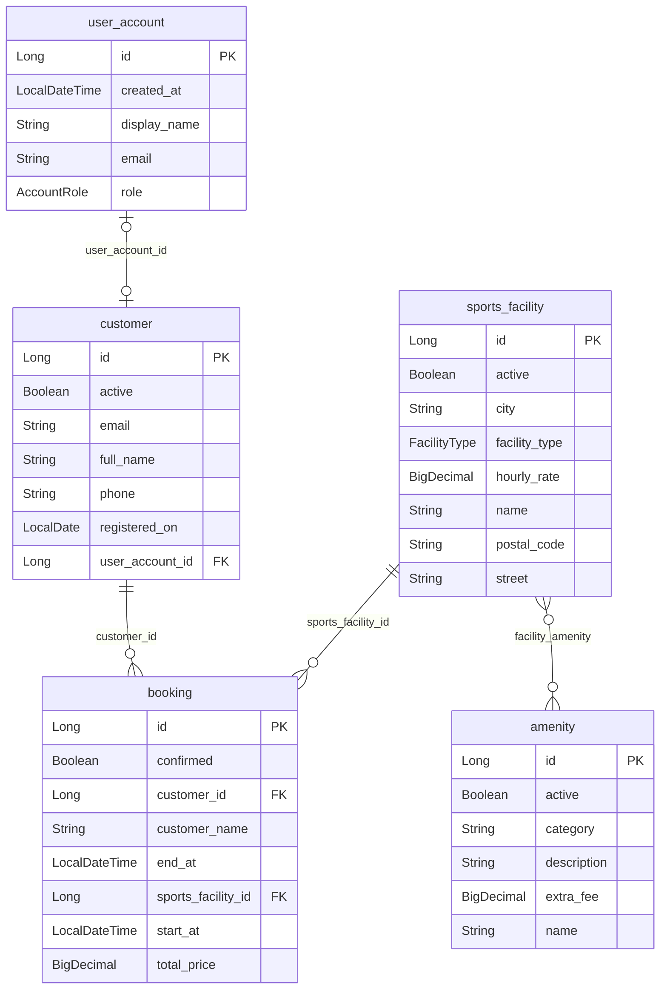

# Schemat bazy danych

Plik generują reguły projektu (panel Maven → Lifecycle → verify). Nie edytujcie go ręcznie.

Tabele: 6 (w tym tabele łączące @ManyToMany: facility_amenity) · kolumny: 34 · relacje: 2 × @ManyToOne, 1 × @OneToMany, 1 × @OneToOne, 1 × @ManyToMany

| Tabela | Encja | Kolumny | Klucze obce |
|---|---|---|---|
| amenity | Amenity | 6 | — |
| booking | Booking | 8 | customer_id, sports_facility_id |
| customer | Customer | 7 | user_account_id |
| sports_facility | SportsFacility | 8 | — |
| user_account | UserAccount | 5 | — |

